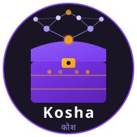

<p align="center">
  
</p>

# kosha-discovery

**Tells your agent — or your code — which model to use and what it costs.**

**Website:** [kosha.srinivas.dev](https://kosha.srinivas.dev)

[](https://github.com/sponsors/sriinnu)
[](https://buymeacoffee.com/sriinnu)

kosha discovers models across 46 providers and local runtimes, plus 21 subscription
plans (token and coding plans) when you hold a key for one. It finds your API keys
wherever they already live (env vars, Claude CLI, Codex, gcloud ADC, AWS SSO), fills
in pricing and context limits, and answers questions like *the cheapest model with
tool use and 128k context that I actually hold a key for*. It ships as a TypeScript
library, a CLI, an HTTP API, an OpenAI-compatible proxy with a spend ledger, and an
MCP server.

It works with no API keys at all: discovery falls back to the public models.dev and
LiteLLM catalogs, so `kosha list` is useful on a fresh machine. Pass `keyless: true`
to `createKosha()` to skip credential lookup entirely.

## Install

```bash
npm install @sriinnu/kosha-discovery       # library / server
npm install -g @sriinnu/kosha-discovery    # global `kosha` CLI
brew install sriinnu/tap/kosha             # same CLI and MCP server, via Homebrew
```

Requires Node.js 22+.

## Quick start

### Library

```typescript
import { createKosha } from "@sriinnu/kosha-discovery";

const kosha = await createKosha();

const models   = kosha.models();                          // ModelCard[] across every provider
const cheapest = kosha.cheapestModels({ role: "image" }); // ranked by price, with missingCredentials
const sonnet   = kosha.model("sonnet");                   // alias → canonical ID; undefined if unknown
console.log(sonnet?.pricing); // { inputPerMillion, outputPerMillion, cacheReadPerMillion, ... } in USD per 1M tokens
```

### CLI

```bash
kosha discover                       # load the 24 h cache, or query every provider when it's cold
kosha list --provider anthropic      # read from the local cache
kosha model sonnet                   # one model, alias-aware
kosha routes claude-opus-5-5         # every serving route for a model (direct, OpenRouter, Bedrock, …)
kosha cheapest --role embeddings     # rank by price for a role
kosha doctor --ci --model opus,gpt6  # fail CI if a model you pin is deprecated, retiring, or gone
kosha spend --since 2026-09-01       # roll up the proxy's spend ledger
kosha ranked --strategy fastest      # routes in the order kosha:<strategy> tries them
kosha providers                      # every provider, with credential status
kosha refresh                        # bypass the cache and re-discover (alias: update)
kosha registry accept openai/gpt-6.1-sol  # release a held price once you've checked it
kosha registry export --output catalog.json  # the catalog as a file, for local mode
kosha serve --port 3000              # HTTP API + proxy; binds 127.0.0.1 (see Proxy below)
```

Every query command takes `--json`. `kosha --help` lists the rest.

After each live discovery (not a cache hit), a stable v1 manifest lands at `~/.kosha/registry.json`:

```bash
jq '.models[] | select(.pricing.inputPerMillion < 0.1) | .modelId' ~/.kosha/registry.json
```

### GitHub Action

Fail a build when a model your code pins is deprecated, about to be retired,
or listed by no provider any more:

```yaml
- uses: sriinnu/kosha-discovery@v1
  with:
    models: |
      claude-opus-5-5
      gpt-6.1-sol
      sonnet
```

Pin it to a commit SHA rather than a moving tag, as you would any action. The
action runs the kosha version it was released with, not `latest`, so a new npm
publish does not change what your CI runs until you move the pin.

It runs `kosha doctor --ci --model …` against the public catalogs (no provider
keys needed), writes a table to the job summary, and annotates each failing
model. A reseller retiring one of its routes is reported but does not fail the
build while the model's own provider still serves it; `deprecation-window`
(default 30 days) sets how far ahead a sunset counts.

### Why trust the prices

Prices come from the provider's own API where it publishes them, then models.dev
and LiteLLM, then kosha's weekly snapshot. `pricingSource` on each card says which.
Catalogs are sometimes wrong, so kosha doesn't take a new price on faith:

- A rate that moves 75% or more in one step is held at the old price and the row
  is tagged `pricing_quarantined`. The new price is accepted after 1 to 7 days,
  depending on whether its sources agree.
- A price under half, or over 4×, the highest price of the last 30 days is held
  too, so it can't walk down in small steps.
- A billed rate that falls to `$0`, or under 1% of the last one, is never released
  by waiting. A catalog `$0` is never ranked cheapest and is refused under a budget.
- While a price is held or its sources disagree, kosha routes and budgets on the
  highest rate anyone reports, so a suspect rise applies at once and a cut waits.
- Negative, NaN and infinite rates are dropped.

Checked a held price against the provider's pricing page? Release it:

```bash
kosha registry accept <provider>/<model>
kosha update
```

The weekly snapshot gets the same gate. Details:
[docs/operations.md](docs/operations.md#clear-a-quarantined-price).

### Public snapshot

A weekly discovery run publishes a full snapshot — every provider, model, price
and limit kosha can see without your keys — at a stable URL:

```bash
curl -sL https://github.com/sriinnu/kosha-discovery/releases/download/snapshot-latest/kosha-latest.json \
  | jq '.modelCount, .providerCount'
```

It's signed: kosha checks `kosha-latest.json.sig` against a built-in key before
using it. Dated `snapshot-YYYY-MM-DD` pre-releases keep a short trail for diffing, pruned to
the two most recent. Each snapshot's release notes list what changed since the
previous one (new models, repricings, deprecations, removals) and any price the
gate is holding. The same diff runs locally with
`pnpm snapshot:diff old.json new.json`.

### HTTP API

```
GET  /api/models?provider=&originProvider=&mode=&capability=
GET  /api/models/:idOrAlias             GET  /api/models/:idOrAlias/routes
GET  /api/models/cheapest?role=…        GET  /api/capabilities
GET  /api/providers[/:id]               GET  /api/roles
GET  /api/resolve/:alias                GET  /api/discovery-errors
GET  /api/discovery[/delta|/watch|/cheapest|/binding]   (stable v1 contract)
POST /api/refresh                       GET  /health          GET  /metrics
GET  /proxy/v1/models                   POST /proxy/v1/chat/completions
```

Parameters and response shapes: [docs/api.md](docs/api.md).

### Proxy

`kosha serve` also exposes an OpenAI-compatible endpoint at `/proxy/v1`. Point any OpenAI SDK at it; the proxy resolves the model or alias, picks a provider you hold credentials for, injects the upstream key, forwards the request, and writes a row to the spend ledger.

```bash
kosha serve   # start on :3000
```

```typescript
import OpenAI from "openai";

const client = new OpenAI({
  baseURL: "http://localhost:3000/proxy/v1",
  apiKey:  "not-used",   // ignored on loopback; set it to KOSHA_PROXY_TOKEN when one is configured
});

// Use any canonical model ID or alias
const res = await client.chat.completions.create({
  model: "sonnet",
  messages: [{ role: "user", content: "hello" }],
});

// Let kosha pick the cheapest model you have a key for
const cheap = await client.chat.completions.create({
  model: "kosha:cheapest",
  messages: [{ role: "user", content: "hello" }],
});

// Cheapest model with tool_use and at least 128k context
const routed = await client.chat.completions.create({
  model: "kosha:cheapest[tool_use,128k]",
  messages: [{ role: "user", content: "hello" }],
});
```

**`kosha:cheapest` filter syntax** (comma-separated, combinable):

| Filter | Example | Meaning |
|--------|---------|---------|
| capability | `tool_use`, `vision` | model must have this tag |
| `<N>k` | `128k`, `200k` | minimum context window |
| `provider:<id>` | `provider:groq` | pin to a specific provider |

`kosha:fastest`, `kosha:reliable`, and `kosha:balanced` take the same filters and rank on observed latency and circuit-breaker state instead of price.

Every response carries `x-kosha-model`, `x-kosha-provider`, `x-kosha-requested` and `x-kosha-attempt-chain`, plus `x-kosha-estimated-cost-usd` except on plan-billed routes. Non-streaming responses add `x-kosha-actual-cost-usd` when the upstream returned a usage block. The full list, including `x-kosha-usage-source` and `x-kosha-wire-notes`, is in [docs/operations.md](docs/operations.md).

What the proxy can forward:

| Upstream wire format | Providers | Support |
|---|---|---|
| OpenAI-compatible | OpenAI, Ollama, OpenRouter, Vercel, Groq, Together, Fireworks, DeepInfra, … | passthrough, streaming included |
| Anthropic Messages | Anthropic, MiniMax Token Plan | translated: streaming, tools, `image_url`, `response_format`, `reasoning_effort`; audio input and non-function tools fail over to an OpenAI-compatible route for the same model |
| Cloud SDKs | Google, Bedrock, Vertex | discovery only, not proxied yet |
| Non-chat / other wire | TypeSafe, Thinking Machines | discovery only — TypeSafe's System One endpoint is not a chat API, and Tinker's Anthropic-wire path differs from Anthropic's own |

Defaults that matter before you expose it:

- The server binds `127.0.0.1`. Pass `--host 0.0.0.0` (or `KOSHA_HOST`) to listen on a network interface.
- Set `KOSHA_PROXY_TOKEN` so `/proxy/*` and `POST /api/refresh` require `Authorization: Bearer <token>` or `x-kosha-token`.
- `/metrics` is open unless `KOSHA_METRICS_TOKEN` is set. `KOSHA_ALLOWED_HOSTS` restricts which `Host` names are answered.
- `KOSHA_MONTHLY_BUDGET_USD` caps spend per calendar month and `KOSHA_TENANT_BUDGET_USD` per tenant. `0` lets nothing paid through; a value that isn't a plain amount stops `kosha serve`.
- The proxy never forwards a Claude subscription OAuth token, and a key is only sent to the host it belongs to.

Reference: [docs/api.md](docs/api.md#openai-compatible-proxy), [docs/operations.md](docs/operations.md), [docs/security.md](docs/security.md).

### MCP server

`kosha-mcp` serves the registry over the Model Context Protocol on stdio, so an agent can call `kosha_query_models`, `kosha_cheapest_model`, `kosha_ranked_routes`, `kosha_model_detail`, `kosha_model_routes`, `kosha_resolve_alias`, `kosha_provider_health`, and `kosha_context_strategy` without an HTTP server.

```bash
claude mcp add kosha -- kosha-mcp
```

It is published to the [MCP registry](https://github.com/modelcontextprotocol/registry)
as `io.github.sriinnu/kosha-discovery`, so clients that read the registry can
install it without a manual command. The manifest is [`server.json`](server.json).

Tools and protocol details: [docs/mcp.md](docs/mcp.md).

## Supported providers

46 pay-as-you-go providers and local runtimes, plus 21 subscription plans generated
from `src/subscription-plans.ts`. Each has a descriptor in `src/provider-catalog.ts`;
most OpenAI-compatible ones are driven from `GENERIC_OPENAI_PROVIDERS` in
`src/discovery/generic-openai.ts` rather than a hand-written class.

| Provider | Discovery | Credential sources |
|----------|-----------|--------------------|
| Anthropic | `GET /v1/models` (context, output cap, capabilities read from the API) | `ANTHROPIC_API_KEY`, Claude CLI, Codex CLI |
| OpenAI | `GET /v1/models` | `OPENAI_API_KEY` |
| Google | `GET /v1beta/models` | `GOOGLE_API_KEY`, `GEMINI_API_KEY`, Gemini CLI, gcloud |
| AWS Bedrock | SDK → CLI → public catalog → static list | `AWS_ACCESS_KEY_ID`, `~/.aws/credentials`, SSO, IAM |
| Vertex AI | API → gcloud → public catalog → static list | `GOOGLE_APPLICATION_CREDENTIALS`, ADC |
| Ollama, llama.cpp, LM Studio, vLLM | local HTTP API | none |
| OpenRouter | API | `OPENROUTER_API_KEY` (optional; unauthenticated is rate-limited) |
| Vercel AI Gateway | `GET /v1/models` | `AI_GATEWAY_API_KEY`, `VERCEL_OIDC_TOKEN` (discovery works without; execution needs one) |
| NVIDIA, Together, Fireworks, Groq, Cerebras, Cohere, DeepInfra, Perplexity | OpenAI-compatible API | `<PROVIDER>_API_KEY` |
| DeepSeek, Mistral, Moonshot (Kimi), GLM (Zhipu), Z.AI, MiniMax | OpenAI-compatible API | `<PROVIDER>_API_KEY` |
| xAI (Grok) | `GET /v1/models`; Grok Imagine split into image / video | `XAI_API_KEY` |
| TypeSafe (System One / Jev) | `GET /v1/models` — returns `judgment` models, not chat | `TYPESAFE_API_KEY`, `JEV_API_KEY` |
| Thinking Machines (Inkling) | Anthropic-wire endpoint, no model list — public catalog only | `TINKER_API_KEY` |
| Alibaba Model Studio (Qwen), Volcengine Ark (Doubao), Inception (Mercury), AI21 (Jamba), Upstage (Solar), StepFun, Meta (Muse Spark) | OpenAI-compatible API | `DASHSCOPE_API_KEY`, `ARK_API_KEY`, `INCEPTION_API_KEY`, `AI21_API_KEY`, `UPSTAGE_API_KEY`, `STEPFUN_API_KEY`, `META_MODEL_API_KEY` |
| Baseten, Nebius Token Factory, Novita AI, SiliconFlow, Hugging Face, Ollama Cloud | OpenAI-compatible API | `<PROVIDER>_API_KEY`, `HF_TOKEN` |

### Subscription plans

A token or coding plan (MiniMax, Moonshot, GLM, Alibaba and others) is listed as
its own provider, but only when a key for it resolves. A plan route has no
per-token price: `kosha cheapest` shows it in an "Included in your plans" group
(`includedInPlans` in the library), and the proxy prefers a plan route you hold.
A plan can borrow the provider's pay-as-you-go key; `KOSHA_PLAN_KEY_PROBE=off`
keeps each plan to its own env vars.

### Regional pairs

Several providers run separate hosts for international and mainland-China
traffic, with separate keys and **separate price sheets**: the same model can
cost several times more on one host than the other. Merging them would make
a model's price depend on which host answered last, so each region is its own
provider:

| International | China | Differs in |
|---|---|---|
| `moonshot` (`api.moonshot.ai`) | `moonshot-cn` (`api.moonshot.cn`) | host, key |
| `minimax` (`api.minimax.io`) | `minimax-cn` (`api.minimaxi.com`) | host, key |
| `alibaba` (`dashscope-intl`) | `alibaba-cn` (`dashscope`) | host, key, pricing |
| `siliconflow` (`.com`) | `siliconflow-cn` (`.cn`) | host, key, pricing |
| `stepfun` (`api.stepfun.ai`) | `stepfun-cn` (`api.stepfun.com`) | host, key, pricing |
| `zai` (`api.z.ai`) | `glm` (`open.bigmodel.cn`) | host, key, pricing |

`kosha routes <model>` lists every region a model is served from, so you can
compare prices across them directly.

Without a key, providers fall back to the public models.dev + LiteLLM catalog, then to kosha's own weekly [snapshot](#public-snapshot) if those are unreachable, then to a curated static list. The same fallback applies when a key is present but rejected: the provider stays listed from the public catalog, shows as unauthenticated, and the error is kept for `kosha doctor`. Exact env var names: [docs/credentials.md](docs/credentials.md).

Config lives in `~/.kosharc.json`, with a per-project `kosha.config.json`. The project file can only make kosha stricter, never point keys somewhere else. See [docs/configuration.md](docs/configuration.md).

To take models.dev and LiteLLM out of the loop, set `KOSHA_CATALOG_SOURCE=pinned` (kosha's snapshot only) or `local` (a file from `kosha registry export`, no network). See [Catalog Source](docs/configuration.md#catalog-source).

### Non-chat modes

Most models are `chat`, but `mode` also covers `embedding`, `image`, `video`,
`audio`, `moderation`, `rerank`, and `judgment`. A `judgment` model — TypeSafe's
System One family — answers a question with a typed value (a choice and its
probability distribution, a probability, or a score on described levels) instead
of generating text. It carries no `chat` capability on purpose: routing a prompt
to one would be a category error.

```bash
kosha cheapest --role judgment    # rank judgment models by price
kosha model jev                   # mode: judgment
```

## How it works

1. **Discovery** — one discoverer per provider runs concurrently (`Promise.allSettled`); each returns normalized `ModelCard`s. A failing provider is recorded in `discoveryErrors()` and doesn't block the others.
2. **Enrichment** — pricing, context window, and output cap are filled from models.dev and LiteLLM where the provider API doesn't publish them; `pricingSource` on each card says which. Cards also carry `releaseDate` and a lifecycle `status` where a catalog publishes them.
3. **Resilience** — a per-provider circuit breaker with exponential cooldown, plus stale-cache fallback, so a provider outage degrades to cached data rather than an error.
4. **Cache and manifest** — results are cached under `~/.kosha/cache/` (24 h TTL) and exported as a versioned snapshot at `~/.kosha/registry.json` for other tools to read.
5. **Proxy** — resolves the requested model or `kosha:<strategy>[filters]` selector against the registry, ranks candidate routes, forwards with failover, and records estimated and reconciled cost in `~/.kosha/ledger-YYYY-MM.jsonl`.

Details: [docs/architecture.md](docs/architecture.md), [docs/resilience.md](docs/resilience.md).

## Development

```bash
pnpm install
pnpm run build        # compile to dist/
pnpm run typecheck    # tsc --noEmit
pnpm run lint         # biome lint
pnpm test             # vitest run
pnpm run check        # lint + build + test

pnpm aliases:check snapshot.json        # built-in aliases that are dead or a generation behind
pnpm snapshot:diff old.json new.json    # what changed between two snapshots
```

The alias table in `src/aliases.ts` is the one part of the catalog written by
hand. `aliases:check` compares it against a snapshot, and the weekly snapshot
run annotates itself with the result, so a bare alias like `opus` falling behind
shows up there rather than in a bug report.

Contributing, the project layout and adding a provider: [CONTRIBUTING.md](CONTRIBUTING.md).

## Docs

| | |
|---|---|
| [Credentials](docs/credentials.md) | Env vars, CLI tools, and config files for every provider |
| [CLI](docs/cli.md) | Commands, flags, examples |
| [HTTP API](docs/api.md) | Endpoints, parameters, response schemas |
| [MCP server](docs/mcp.md) | Tools, protocol negotiation, client setup |
| [Configuration](docs/configuration.md) | Aliases, routing, enrichment, programmatic config |
| [Architecture](docs/architecture.md) | Discovery flow, module map, adding providers |
| [Resilience](docs/resilience.md) | Circuit breakers, stale cache, health |
| [Operations](docs/operations.md) | Deployment sizing, metrics, spend ledger, recovery recipes |
| [Security](docs/security.md) | Threat catalogue, runtime scanning, pre-commit hook; report issues per [SECURITY.md](SECURITY.md) |
| [Discovery Plane v1](docs/discovery-plane-v1.md) | Stable daemon contract (deltas, SSE watch, binding hints) |

The same pages are mirrored to the [wiki](https://github.com/sriinnu/kosha-discovery/wiki), alongside guides that only live there (troubleshooting, the release runbook). `docs/` is the source: the mirror is regenerated on every push to `main`, so edit here, not there.

## Release

1. Bump the version in `package.json`, in `server.json` (twice: top level and `packages[0]`), and the `default` in `action.yml`. Date the `[Unreleased]` section in `CHANGELOG.md`, and merge that as a PR.
2. Tag and push:

```bash
git tag -s vX.Y.Z -m "vX.Y.Z" && git push origin vX.Y.Z
gh workflow run release-npm.yml --ref vX.Y.Z -f tag=vX.Y.Z -f publish_mcp=false
```

The workflow checks that the tag matches `package.json`, runs lint / build / test, stages the package on npm with provenance, and creates the GitHub Release. Staging authenticates through npm trusted publishing (OIDC); there is no npm token. The version goes live only after a maintainer approves it with 2FA:

```bash
npm stage list @sriinnu/kosha-discovery
npm stage approve <id>
gh workflow run release-npm.yml --ref vX.Y.Z -f tag=vX.Y.Z -f publish_npm=false -f create_github_release=false   # publish to the MCP registry once npm is live
```

Every step, with the parts that are easy to forget: the [release runbook](https://github.com/sriinnu/kosha-discovery/wiki/Release-Runbook).

## Support

kosha is free and open source. If it helps you pick cheaper models, consider sponsoring its upkeep:

- [GitHub Sponsors](https://github.com/sponsors/sriinnu)
- [Buy Me a Coffee](https://buymeacoffee.com/sriinnu)

## License

MIT
